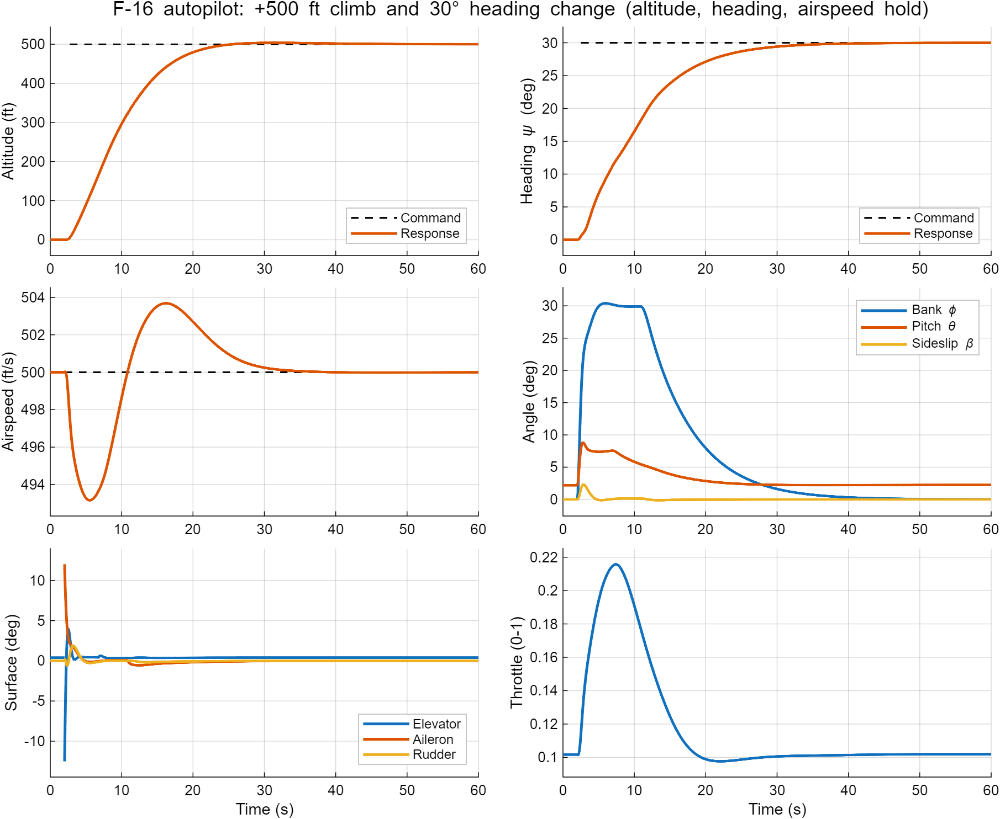
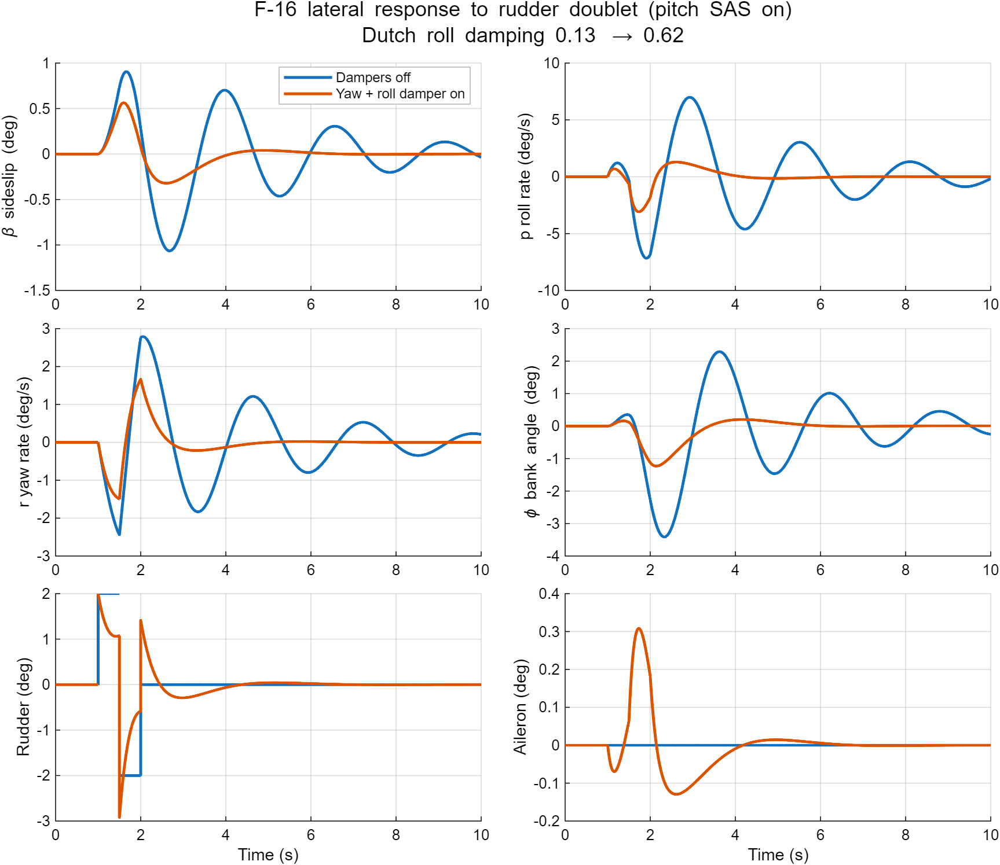
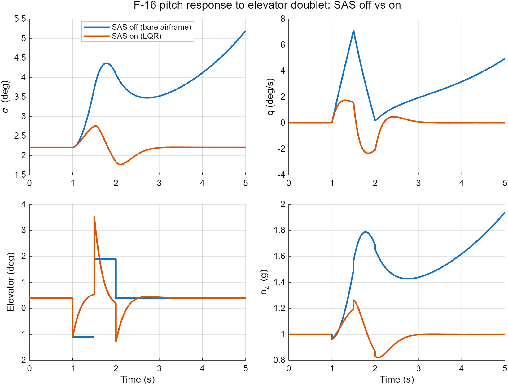
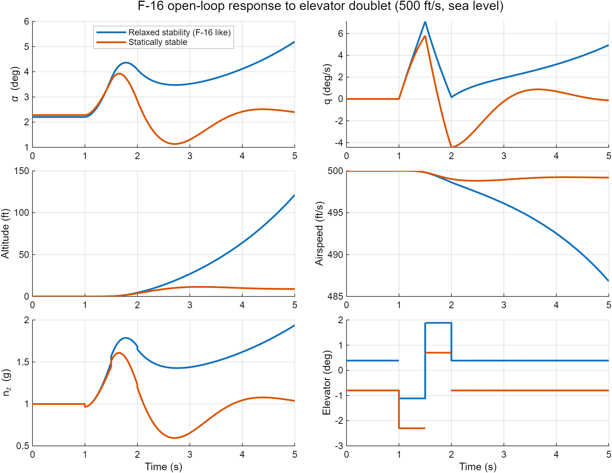

# F-16 Flight Dynamics and Control (MATLAB)

Nonlinear 6-DOF flight model of an F-16-style fighter, with trim, linearization, stability augmentation (pitch, yaw and roll) and an autopilot that holds altitude, heading and airspeed. Built in MATLAB.

The F-16 is designed with relaxed static stability: very agile, but the bare airframe is unstable and needs a flight control computer to fly. This project reproduces that effect, stabilizes the airframe with feedback, and then flies it with an autopilot.

## Results

**Step 4: Autopilot.** A +500 ft climb and a 30 degree heading change commanded at the same time, with airspeed held at 500 ft/s.

**Step 3: Lateral SAS.** Rudder doublet with the yaw and roll dampers off and on (pitch SAS on in both runs).

**Step 2: Pitch SAS.** The unstable airframe with the pitch SAS off and on.

**Step 1: Open-loop response.** The same elevator doublet applied to an F-16-like unstable airframe and to a statically stable one, with no controller.

### Key numbers (500 ft/s, sea level, level flight)

| Area | Result |
|---|---|
| Trim | alpha 2.20 deg, throttle 0.102, elevator 0.39 deg, residual about 1e-11 |
| Bare airframe | unstable short-period pole at +0.458 /s (doubling time about 1.5 s) |
| Pitch SAS (LQR) | short-period poles move to -3.87 ± 2.50i (damping about 0.84); gains K_w = -0.0028, K_q = -0.554 |
| Lateral SAS | dutch-roll damping 0.13 to 0.62; peak sideslip 1.06 to 0.56 deg; peak roll rate 7.2 to 3.1 deg/s; sideslip settles in 3.8 s instead of 9.4 s |
| Autopilot altitude | 3.7 ft overshoot, within 25 ft of target after 19.4 s, final 500.0 ft |
| Autopilot heading | no overshoot, within 1 deg after 26.6 s, final 30.0 deg |
| Autopilot airspeed | 493.2 to 503.7 ft/s, final 500.0 ft/s |
| Autopilot attitude | peak bank 30.4 deg, peak pitch 8.8 deg, peak sideslip 2.3 deg |

### Open-loop modes (F-16-like case)

| Mode | Poles |
|---|---|
| Short period | -2.34 and **+0.458** (unstable) |
| Phugoid | -0.020 ± 0.116i (period about 50 s) |
| Dutch roll | -0.321 ± 2.429i (damping about 0.13) |
| Roll | -3.43 |
| Spiral | -0.018 |

## What is implemented

- **Nonlinear 6-DOF model** in body axes with 13 states: body velocities (u, v, w), Euler angles, body rates, position, altitude and engine power. It includes an ISA atmosphere, wind-to-body force transformation, inertia coupling (Ixz) and a first-order engine lag.
- **Trim solver** for steady level flight (`fminsearch` over angle of attack, throttle and elevator).
- **Numerical linearization** (central differences) and mode analysis.
- **Pitch SAS:** LQR on the short-period subsystem, feeding back w (about angle of attack) and pitch rate q to the elevator.
- **Lateral SAS:** yaw rate to rudder through a 1 s washout filter (gain chosen with `fminbnd` to maximize dutch-roll damping), and roll rate to aileron (K_p = 0.10). The washout lets the damper resist dutch roll without fighting steady turns.
- **Autopilot** built from nested loops on top of the stability augmentation:
  - Altitude error sets a climb-rate command (limited to 50 ft/s), which sets a pitch command (PI), which drives the elevator through a pitch-attitude loop (PI).
  - Heading error sets a bank-angle command (limited to 30 deg), which drives the ailerons.
  - A PI autothrottle holds airspeed.

## How to run

Requirements:
- MATLAB R2020a or newer (uses `exportgraphics`)
- Control System Toolbox (`lqr`, `damp`)

Steps:
1. Put all files in one folder and make it MATLAB's current folder.
2. Run `run_f16_step1` for trim, modes and the open-loop doublet simulation.
3. Run `run_f16_step2_sas` for the pitch SAS design and the SAS off vs on comparison.
4. Run `run_f16_step3_lateral_sas` for the yaw and roll dampers, off vs on.
5. Run `run_f16_step4_autopilot` for the altitude, heading and airspeed hold autopilot.

Each script prints its results in the Command Window and saves a PNG in the current folder.

The `run_` files are the entry points. The other files are functions called by them and are not meant to be run directly.

## Files

| File | Purpose |
|---|---|
| `run_f16_step1.m` | Trim, linearization, open-loop simulation and plot |
| `run_f16_step2_sas.m` | LQR pitch SAS design and comparison plot |
| `run_f16_step3_lateral_sas.m` | Yaw damper and roll damper design and comparison plot |
| `run_f16_step4_autopilot.m` | Altitude, heading and airspeed hold autopilot |
| `f16_dynamics.m` | Nonlinear 6-DOF equations of motion |
| `f16_trim.m` | Steady level-flight trim solver |
| `f16_params.m` | Aircraft constants and aerodynamic coefficients |

## Conventions

- Units: ft, slug, lb, rad, s
- Body axes, flat earth
- Elevator: positive = trailing edge down = nose down
- Control vector: `[throttle (0 to 1); elevator; aileron; rudder]`, surfaces in radians
- State vector: `[u v w phi theta psi p q r pn pe h pow]`

## Limitations

- Mass, inertia and geometry follow the Stevens & Lewis F-16, but the **aerodynamic coefficients are simplified linear values**, not the NASA TP-1538 lookup tables. The model shows realistic qualitative behavior (relaxed stability, unstable short period) but is not validated against real F-16 data.
- There is no stall model, so results are only meaningful at moderate angles of attack.
- The autopilot commands are instant steps, so the elevator (about -12.5 deg) and aileron (about 12 deg) spike at the start of the maneuver. Command shaping and actuator dynamics would smooth this.
- No actuator dynamics or rate limits, sensor noise or gusts yet.
- The lateral dampers use rate feedback only, so dutch-roll damping tops out near 0.6. Adding sideslip feedback would raise it.

## Roadmap

- [x] Nonlinear model, trim and linearization
- [x] Pitch SAS (LQR)
- [x] Yaw damper and roll damper
- [x] Autopilot: altitude, heading and airspeed hold
- [ ] PID vs LQR comparison
- [ ] Command shaping, actuator dynamics, sensor noise and gusts
- [ ] Gain scheduling across the flight envelope
- [ ] NASA TP-1538 aerodynamic tables
- [ ] 3D flight playback

## References

- B. L. Stevens and F. L. Lewis, *Aircraft Control and Simulation*, Wiley.
- L. T. Nguyen et al., *Simulator Study of Stall/Post-Stall Characteristics of a Fighter Airplane With Relaxed Longitudinal Static Stability*, NASA TP-1538, 1979.

## Author

Viraj Pradhan
LinkedIn: [add your profile link]

## License

MIT, see [LICENSE](LICENSE).
