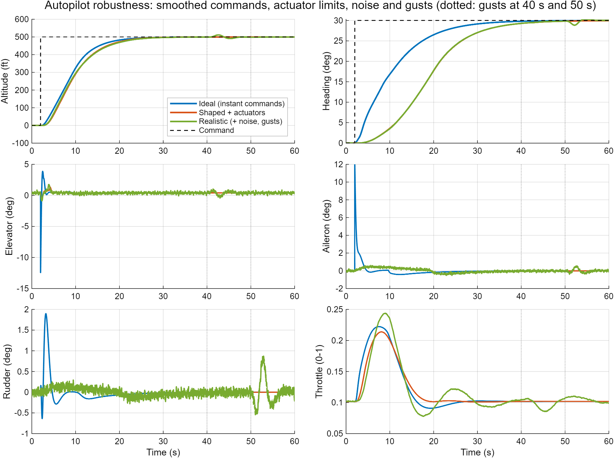
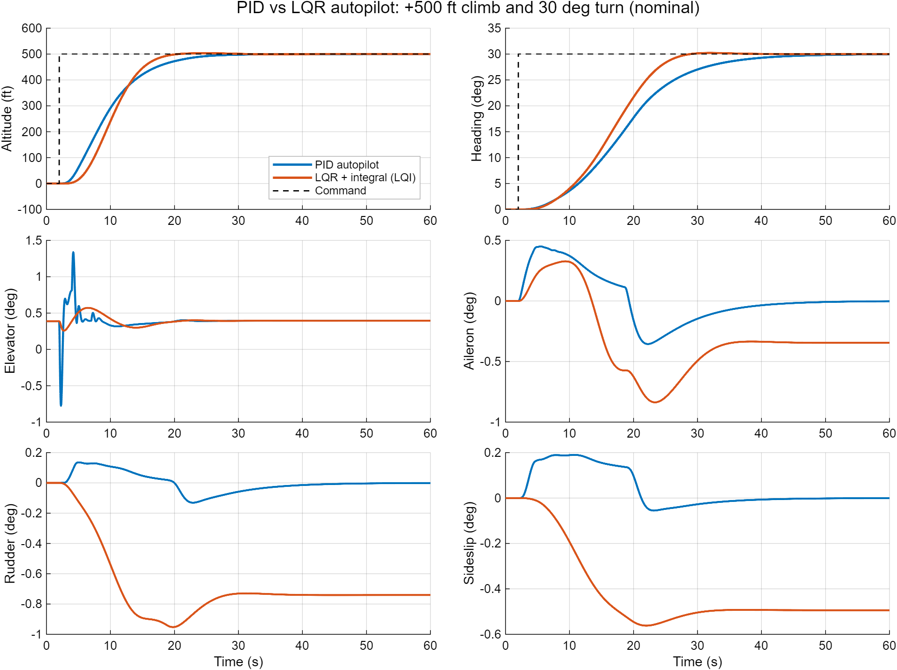
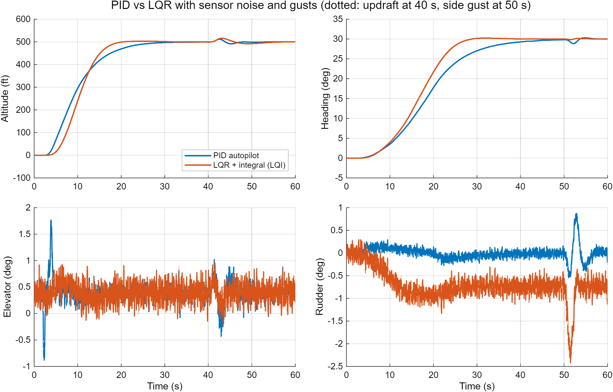
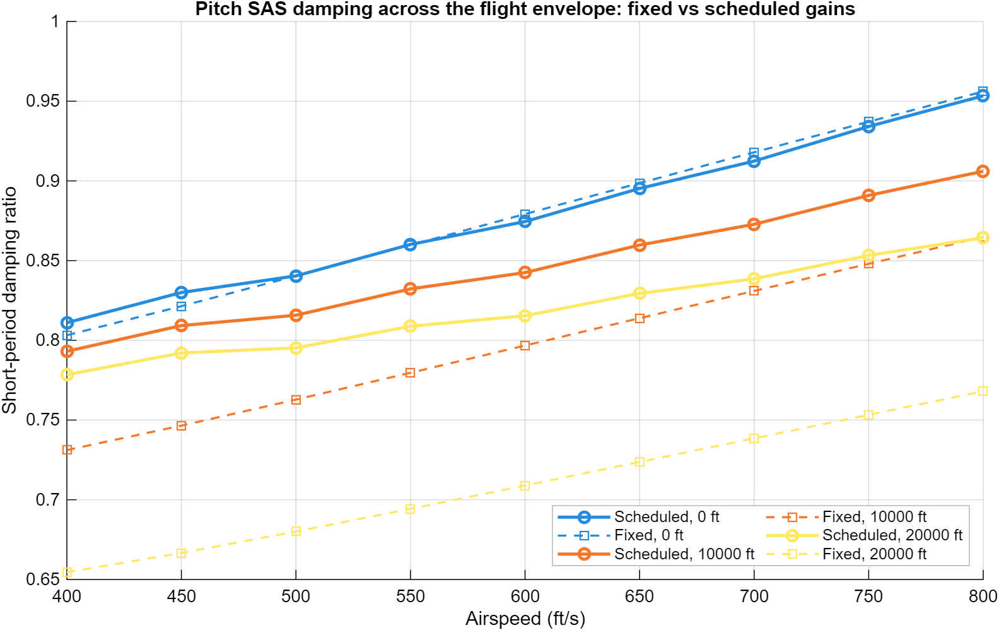
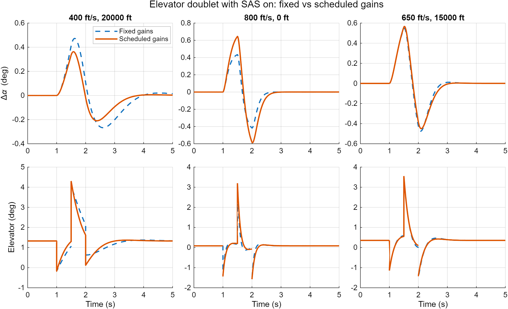
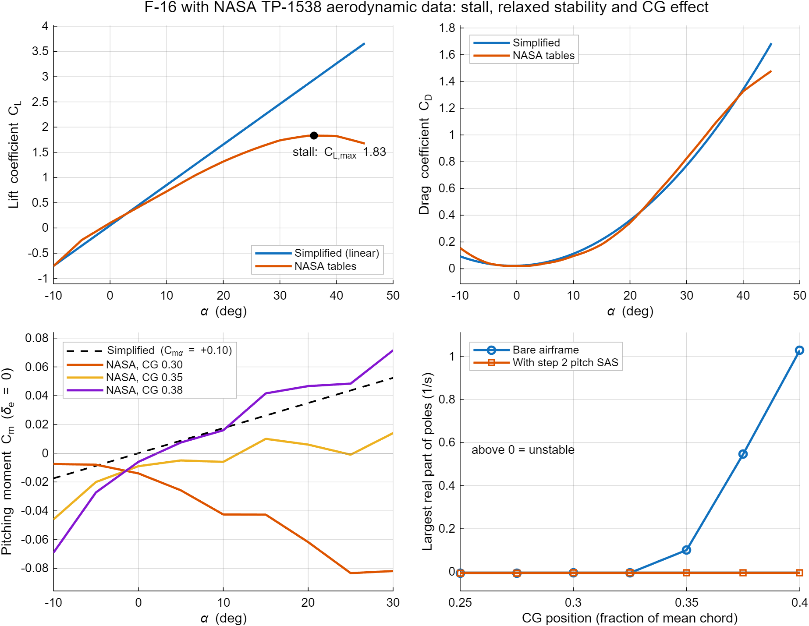
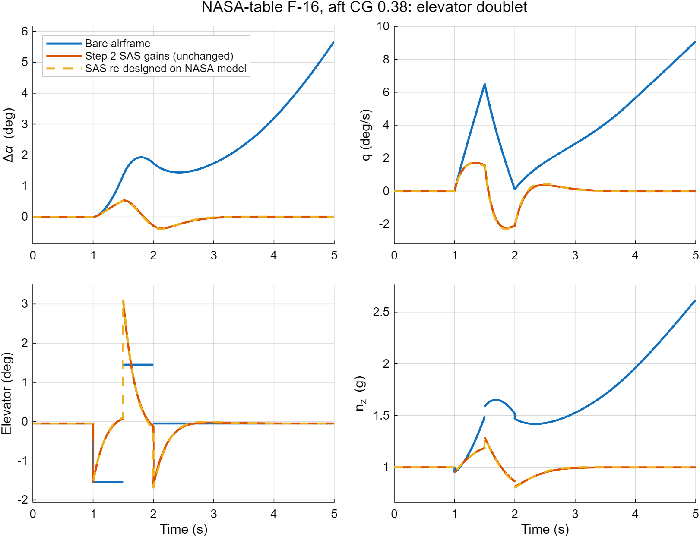

# F-16 Flight Dynamics and Control (MATLAB)

Nonlinear 6-DOF flight model of an F-16-style fighter, with trim, linearization, stability augmentation (pitch, yaw and roll), an autopilot that holds altitude, heading and airspeed, robustness tests, a PID vs LQR comparison, gain scheduling, a 3D flight playback, and a second aerodynamic model built from the NASA TP-1538 wind-tunnel data. Built in MATLAB.

The F-16 is designed with relaxed static stability: very agile, but the bare airframe is unstable and needs a flight control computer to fly. This project reproduces that effect, stabilizes the airframe with feedback, flies it with an autopilot, and then stress-tests the result.

## Results

### Autopilot (+500 ft climb and 30 deg turn at 500 ft/s)

### Robustness: smoothed commands, actuator limits, sensor noise and gusts

### PID vs LQR with integral action

### Gain scheduling of the pitch SAS

### Lateral SAS, pitch SAS and open-loop response

### NASA TP-1538 wind-tunnel aerodynamics (step 9)

### 3D playback

`run_f16_step7_playback` flies the mission and writes `f16_step7_playback.mp4` (chase camera, jet drawn 25x larger so it is visible at mission scale).

## Key numbers (500 ft/s, sea level, level flight)

| Area | Result |
|---|---|
| Trim | alpha 2.20 deg, throttle 0.102, elevator 0.39 deg, residual about 1e-11 |
| Bare airframe | unstable short-period pole at +0.458 /s (doubling time about 1.5 s) |
| Pitch SAS (LQR) | short-period poles move to -3.87 ± 2.50i (damping about 0.84) |
| Lateral SAS | dutch-roll damping 0.13 to 0.62; sideslip settles in 3.8 s instead of 9.4 s |
| Gain scheduling | worst-case short-period damping over 400 to 800 ft/s and 0 to 20,000 ft: 0.65 (fixed gains) to 0.78 (scheduled) |
| NASA tables: validation | trim at 502 ft/s: alpha 2.123 deg, elevator -0.758 deg vs published Stevens & Lewis 2.12 deg, -0.76 deg |
| NASA tables: stall | maximum lift coefficient 1.83 at alpha 36 deg (the simplified model has no stall) |
| NASA tables: stability | unstable pole +0.10 /s at the reference CG (0.35), +1.03 /s at CG 0.40; stable at CG 0.325 and forward |
| NASA tables: SAS | step 2 pitch SAS, unchanged, stabilizes every CG from 0.25 to 0.40 (short-period damping 0.86 to 0.93) |

### Command shaping and actuators (step 5)

| | Instant commands | Shaped + actuator limits |
|---|---|---|
| Peak elevator | -12.4 deg | -0.8 deg (max +1.3 deg) |
| Peak aileron | 12.0 deg | 0.45 deg |
| Peak rudder | 1.9 deg | 0.13 deg |
| Heading within 1 deg | 26.9 s | 35.7 s |

Smoother commands remove surface spikes no real actuator could follow, at the cost of a slower turn.

With sensor noise, a 15 ft/s updraft at 40 s and a 10 ft/s side gust at 50 s, the autopilot stays on track: about 11.4 ft altitude error from the updraft, 1.15 deg heading error and 0.85 deg sideslip from the side gust.

### NASA TP-1538 aerodynamic tables (step 9)

The simplified linear aerodynamics are replaced by the F-16 wind-tunnel data from NASA TP-1538, in the tabulated form given by Stevens & Lewis (lift, drag, side force and the three moments as functions of angle of attack, sideslip and control deflections, plus damping derivatives). Only the aerodynamics change; mass, inertia, atmosphere and engine stay the same, so the comparison isolates the effect of the real data.

| | Simplified model | NASA tables (CG 0.35) |
|---|---|---|
| Trim alpha (500 ft/s) | 2.20 deg | 2.15 deg |
| Trim elevator | 0.39 deg | -0.76 deg |
| Unstable longitudinal pole | +0.458 /s (doubling 1.5 s) | +0.101 /s (doubling 6.9 s) |
| Dutch roll | -0.321 ± 2.429i | -0.423 ± 3.055i |
| Roll mode | -3.43 | -3.60 |
| Stall | none | C_L max 1.83 at 36 deg |

Moving the centre of gravity aft makes the real aircraft more unstable (doubling time 1.1 s at CG 0.38), which is exactly why the F-16 needs its flight control computer. The pitch SAS from step 2, designed on the simplified model, still stabilizes the NASA-table aircraft at every CG tested. Re-designing it on the NASA model (K_w = -0.0032, K_q = -0.538) gives almost the same response: after an elevator doublet at CG 0.38, the bare airframe diverges (alpha +5.7 deg and still growing after 5 s) while both SAS versions keep the alpha change to about 0.5 deg and settle about 1 s after the doublet ends.

### PID vs LQR with integral action (step 6)

Same mission, same shaped commands, same actuators, same autothrottle. Only the altitude and heading control differs.

| | PID nominal | LQI nominal | PID with gusts | LQI with gusts |
|---|---|---|---|---|
| Altitude overshoot (ft) | -0.02 | 3.37 | 11.37 | 15.73 |
| Altitude within 25 ft (s) | 18.4 | 14.7 | 19.0 | 14.6 |
| Heading within 1 deg (s) | 35.7 | 24.0 | 50.6 | 24.0 |
| Peak sideslip (deg) | 0.19 | 0.56 | 0.85 | 1.36 |
| Elevator RMS (deg) | 0.12 | 0.05 | 0.22 | 0.18 |
| Aileron RMS (deg) | 0.20 | 0.44 | 0.23 | 0.54 |
| Rudder RMS (deg) | 0.06 | 0.73 | 0.15 | 0.79 |

Neither design wins outright. LQI tracks heading faster and rejects the side gust better (0.17 deg heading error vs 1.15 deg) and uses less elevator, but it uses far more rudder, lets more sideslip build up, and rejects the vertical gust worse (15.7 ft vs 11.4 ft). Both designs are hand-tuned by me, so this compares these two tunings, not PID and LQR in general. Noise runs use random numbers, so gust results vary slightly between machines.

## Where this can be used

- **Learning and teaching flight dynamics.** Every step is a short script with printed numbers and a plot, so it can be followed one concept at a time: trim, modes, stability augmentation, autopilot, robustness.
- **A test bench for control ideas before hardware.** New controllers (PID, LQR, gain-scheduled, or anything else) can be tried on the same mission and compared with the same metrics.
- **Prototyping UAV and drone autopilots.** The cascaded structure here (altitude to climb rate to pitch to elevator, heading to bank to aileron, inner rate dampers) is the same layered idea used in common open-source drone autopilots.
- **A starting point for further work** such as hardware-in-the-loop tests, flight-simulator integration or fault-tolerant control.

It is not intended for real aircraft design or certification (see Limitations).

## How this differs from the usual approach

- **No Simulink and no Aerospace Blockset.** The equations of motion, trim, linearization and controllers are written out in plain MATLAB functions, so every force, moment and gain can be read and checked. Only `lqr`/`damp` from the Control System Toolbox are used.
- **Nonlinear simulation, not just a linear model.** Many student projects stop at transfer functions or a linear state-space model. Here every controller is designed on the linear model but tested on the full nonlinear 6-DOF aircraft.
- **A fair PID vs LQR comparison.** Both controllers fly the same mission with the same shaped commands, actuators, autothrottle, noise and gusts, and the result is reported honestly: neither wins outright.
- **Realism added step by step.** Command shaping, actuator rate limits, sensor noise, gusts and gain scheduling are added one at a time, so the effect of each one is visible.
- **Reproducible results.** Each script prints the numbers quoted in this README, so anyone can re-run and check them.

## Challenges and how I solved them

| Problem | Cause | Fix |
|---|---|---|
| The aircraft diverged within seconds of any input | Relaxed static stability (Cm_alpha > 0) gives an unstable short-period pole, doubling time about 1.5 s | LQR pitch SAS before any autopilot work |
| The yaw damper fought steady turns | Pure yaw-rate feedback opposes the constant yaw rate a turn needs | 1 s washout filter so only oscillations are damped |
| Dutch-roll damping stopped improving near 0.6 | Limit of rate-only feedback | Gain chosen by optimization (`fminbnd`); documented as a limitation |
| The aircraft lost height in banked turns | Extra lift is needed when banked | Integral action in the climb-rate and pitch loops |
| Elevator spiked to -12 deg and aileron to 12 deg at the start of the mission | Instant step commands | Command shaping plus actuator rate and position limits (peaks dropped to about 1 deg and 0.5 deg) |
| Throttle kept oscillating in the noisy run | Autothrottle gain too high for the sensor filter and engine lag | Halved the autothrottle gains |
| Damping changed across speed and altitude | Gains designed at one flight condition | Gain scheduling over 15 trim points (worst case 0.65 to 0.78) |
| Exported plots were unreadable or showed toolbar icons | MATLAB dark theme and the axes toolbar in exports | Forced a white background with black text and hid the toolbar before export |
| No access to the real F-16 aerodynamic data at the start | The NASA TP-1538 tables are large, and one mistyped number would silently corrupt the model | Simplified linear coefficients first; later the tables were copied programmatically from a public source, checked value by value (max difference about 1e-14), and validated against the published Stevens & Lewis trim |
| The real data gave a different aircraft | Different stability, trim and stall behavior than the simplified model | Added the tables as a separate model file so steps 1 to 8 stay reproducible, then checked that the existing SAS still works |
| `griddedInterpolant` is not available everywhere | It is missing in GNU Octave | Wrote a small interpolation routine with linear extrapolation, matching the original Stevens & Lewis code |

## What is implemented

- **Nonlinear 6-DOF model** in body axes with 13 states: body velocities (u, v, w), Euler angles, body rates, position, altitude and engine power. It includes an ISA atmosphere, wind-to-body force transformation, inertia coupling (Ixz), a first-order engine lag and an optional wind input for gusts.
- **Trim solver** for steady level flight (`fminsearch` over angle of attack, throttle and elevator).
- **Numerical linearization** (central differences) and mode analysis.
- **Pitch SAS:** LQR on the short-period subsystem, feeding back w (about angle of attack) and pitch rate q to the elevator.
- **Lateral SAS:** yaw rate to rudder through a 1 s washout filter (gain chosen with `fminbnd` to maximize dutch-roll damping), and roll rate to aileron.
- **PID autopilot:** altitude error sets a climb-rate command, which sets a pitch command, which drives the elevator; heading error sets a bank command, which drives the ailerons; a PI autothrottle holds airspeed.
- **LQI autopilot:** LQR with integral action for the longitudinal axis [w, theta, q, h] and the lateral axes [v, phi, p, r, psi].
- **Realism:** command shaping, first-order actuators with position and rate limits, sensor noise with light filtering, vertical and lateral gusts.
- **Gain scheduling:** pitch SAS gains designed at 15 trim points and interpolated across speed and altitude.
- **3D playback** with plain MATLAB graphics, saved as MP4.
- **NASA TP-1538 aerodynamic tables:** a second dynamics model with the same interface, using table look-up with linear interpolation and extrapolation (no toolbox needed), centre-of-gravity shift, and validation against the published Stevens & Lewis trim.

## How to run

Requirements:
- MATLAB R2020a or newer (uses `exportgraphics`)
- Control System Toolbox (`lqr`, `damp`)

Put all files in one folder, make it MATLAB's current folder, and run:

| Script | What it does | Output |
|---|---|---|
| `run_f16_step1` | Trim, modes, open-loop doublet | `f16_step1_openloop.png` |
| `run_f16_step2_sas` | Pitch SAS off vs on | `f16_step2_sas.png` |
| `run_f16_step3_lateral_sas` | Yaw and roll dampers off vs on | `f16_step3_lateral_sas.png` |
| `run_f16_step4_autopilot` | Altitude, heading and airspeed hold | `f16_step4_autopilot.png` |
| `run_f16_step5_robustness` | Shaping, actuators, noise and gusts | `f16_step5_robustness.png` |
| `run_f16_step6_pid_vs_lqr` | PID vs LQR comparison | `f16_step6_pid_vs_lqr.png`, `f16_step6_realistic.png` |
| `run_f16_step7_playback` | 3D flight playback | `f16_step7_playback.mp4` |
| `run_f16_step8_gain_scheduling` | Gain scheduling | `f16_step8_damping.png`, `f16_step8_doublets.png` |
| `run_f16_step9_nasa_aero` | NASA tables: validation, stall, CG study, SAS check | `f16_step9_aero.png`, `f16_step9_nasa_sas.png` |

The `run_` files are the entry points. The other files are functions called by them and are not meant to be run directly.

## Files

| File | Purpose |
|---|---|
| `f16_params.m` | Aircraft constants and aerodynamic coefficients |
| `f16_dynamics.m` | Nonlinear 6-DOF equations of motion (optional wind input) |
| `f16_trim.m` | Steady level-flight trim solver |
| `f16_design.m` | Designs all gains (SAS, dampers, PID, LQI) at the 500 ft/s trim point |
| `f16_fly.m` | Closed-loop mission simulator (PID or LQI, optional realism features) |
| `f16_metrics.m` | Performance numbers for one run |
| `f16_aero_nasa.m` | NASA TP-1538 aerodynamic tables and interpolation |
| `f16_dynamics_nasa.m` | 6-DOF model using the NASA tables (same interface as `f16_dynamics.m`, optional `P.xcg`) |
| `f16_gain_schedule.mat` | Gain tables saved by step 8 |
| `run_f16_step*.m` | Entry-point scripts listed above |

## Conventions

- Units: ft, slug, lb, rad, s
- Body axes, flat earth
- Elevator: positive = trailing edge down = nose down
- Control vector: `[throttle (0 to 1); elevator; aileron; rudder]`, surfaces in radians
- State vector: `[u v w phi theta psi p q r pn pe h pow]`

## Limitations

- Steps 1 to 8 use **simplified linear aerodynamic coefficients**, which show realistic qualitative behavior (relaxed stability, unstable short period) but no stall. Step 9 adds the NASA TP-1538 tables as a second model; the autopilot, PID vs LQR and gain-scheduling studies have not yet been repeated on it.
- The NASA tables are the low-fidelity Stevens & Lewis version (alpha -10 to 45 deg, no leading-edge flap, no Mach effects), so the model is valid only at subsonic speeds. Engine angular momentum and the full afterburning engine model are not included; the project keeps its simpler engine.
- Actuators are simple first-order lags with rate and position limits. Sensor noise and gust models are simple, not standard turbulence models.
- The PID and LQI autopilots are hand-tuned by me; the comparison reflects these tunings.
- The lateral dampers use rate feedback only, so dutch-roll damping tops out near 0.6.

## Roadmap

- [x] Nonlinear model, trim and linearization
- [x] Pitch SAS (LQR)
- [x] Yaw damper and roll damper
- [x] Autopilot: altitude, heading and airspeed hold
- [x] Command shaping, actuator dynamics, sensor noise and gusts
- [x] PID vs LQR comparison
- [x] Gain scheduling
- [x] 3D flight playback
- [x] NASA TP-1538 aerodynamic tables (separate model, steps 1 to 8 unchanged)
- [ ] Repeat the autopilot and gain-scheduling studies on the NASA-table model

## References

- B. L. Stevens and F. L. Lewis, *Aircraft Control and Simulation*, Wiley.
- L. T. Nguyen et al., *Simulator Study of Stall/Post-Stall Characteristics of a Fighter Airplane With Relaxed Longitudinal Static Stability*, NASA TP-1538, 1979.
- Table values were cross-checked against the open-source AeroBenchVV F-16 model (S. Bak et al., github.com/stanleybak/AeroBenchVVPython). No code from that project is used.

## Author

Viraj Pradhan
LinkedIn: [linkedin.com/in/virajdpradhan](https://www.linkedin.com/in/virajdpradhan)

## License

MIT, see [LICENSE](LICENSE).
